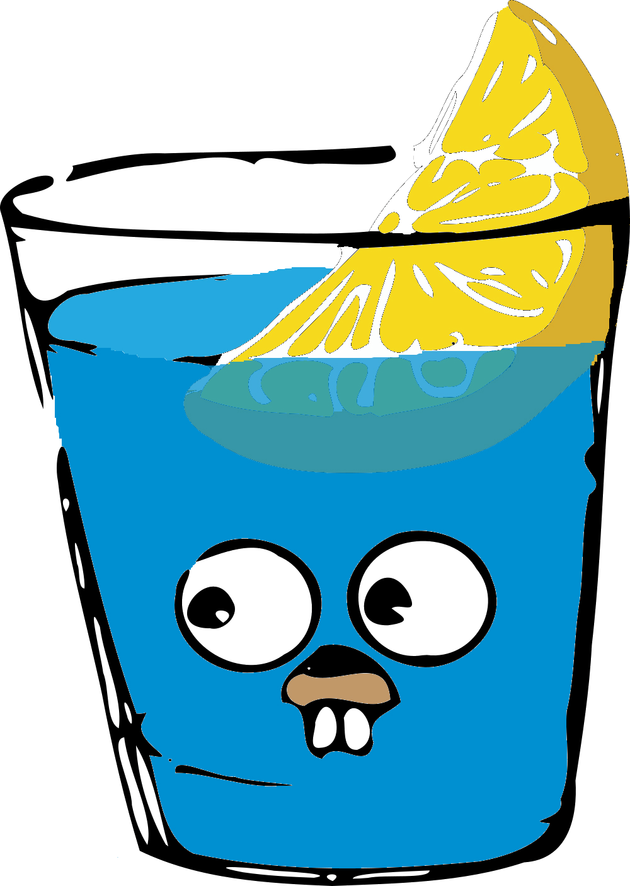

# Yo, I'm Sypher. Backend Engineer

 

 

  

<h2>Projects</h2>

<table>
<tr>
<td width="50%" valign="top">

<h3>Ticket-Master</h3>

Ticket management service.

</td>

<td width="50%" valign="top">

<h3>Pushy-Notify</h3>

Telegram bot for GitHub commit notifications.

</td>
</tr>

<tr>
<td width="50%" valign="top">

<h3>Qr-code-gen</h3>

Service of generation qr codes.

</td>

<td width="50%" valign="top">

<h3>MD5-checker</h3>

REST api service for sharing information about threats.

</td>
</tr>
</table>

  

<h2 align="center">GitHub Statistics</h2>

  <table>
    <tr>
      <td align="center" width="50%">
        
      </td>
      <td align="center" width="50%">
        
      </td>
    </tr>
  </table>

 

  <code>keep building.</code>

